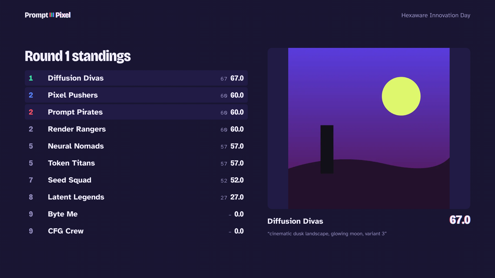

# Prompt to Pixel

A two-round AI image challenge for corporate events. Teams write prompts in any AI image generator, upload their best result, and an AI judge scores every entry blind. The game is fully cloud-hosted on **free tiers only** (Cloudflare Workers + Neon), with no server on anyone's laptop.

| Round | What happens | Judged on (points per spin) |
|---|---|---|
| 1 · Scene Recall | A wheel picks one of 12 original movie scenes. It shows for ~8 s, then hides. Teams recreate it from memory with any AI image generator (4–5 min). Spin as many scenes as you like. | composition 25, subject 25, colour & lighting 20, style 15, detail 15 |
| 2 · Movie Mashup | Three reels pick a genre, a hero and a setting. Teams design that movie's poster. | each pick 15 × 3, fusion 20, creativity 15, visual quality 20 |

Teams join BID WARS style: scan one QR code, tap a free team number, name the team and make up their own PIN (teammates join with that PIN). The host console is one big "next step" button.

The rules are a **draft** (see `src/shared/rubrics.ts`), written from scratch — review them with the organisers.



## Architecture

```
 Phones / projector / host (React + Vite + Tailwind + Motion)
   │  static assets: free, unlimited            │ /api/* only
   ▼                                            ▼
 Cloudflare Worker (Hono) ── Workers AI (vision judge)
   │  submit → job row (same transaction) → Queue message {jobId}
   │  Queue consumer: claim → judge → Zod → backend total → publish once
   │  Cron (every min): close expired rounds, recover lost/stuck jobs, resume paused
   ▼
 Neon Postgres (Singapore) ── Neon Object Storage (private bucket) | BYTEA fallback
```

- **Zero-cost guards.** Hard daily budgets for AI neurons, requests and storage. Jobs pause (and are kept) when a budget is reached, and resume automatically. Details: [docs/FREE_TIER_REPORT.md](docs/FREE_TIER_REPORT.md).
- **The 10 ms CPU limit.** Compression, the 512 px judge copy, thumbnails and duplicate hashes are all made in the browser. The Worker only streams bytes.
- **Fair judging.**
  - The judge sees pixels only: no team names, no prompts.
  - Scoring anchors are fixed, and the AI's 0–10 scores are validated by Zod. Totals are computed on the backend.
  - The model is locked per round, and a failed evaluation is never filled in with invented points.
  - Exact and near duplicates and reference copies are held for the host.
  - Text in an image that tries to instruct the judge is flagged.
- **Reliability.**
  - Job rows are created in the same transaction as the submission.
  - Processing is idempotent: a conditional claim, a unique result per job, and at most one published result per submission.
  - Failures retry with exponential backoff and jitter. Concurrency is configurable.
  - Lease recovery and cron reconciliation catch anything lost.
- **Sync.** Adaptive, server-directed polling with ETags and 304s. Countdowns are rendered locally from a server deadline with an NTP-style clock offset.

## Commands

| | |
|---|---|
| `npm test` | 31 unit and integration tests against a real Postgres (PGlite) |
| `npm run build` | Type-check and build |
| `npm run setup` | One-time free-tier deployment ([docs/DEPLOYMENT.md](docs/DEPLOYMENT.md)) |
| `npm run benchmark` | Real Workers AI model benchmark → `docs/reports/BENCHMARK.md` |
| `npm run loadtest:local` | 100 sessions against the local stack (simulated judge) |
| `npm run loadtest:remote` | 100 sessions against your deployment (real AI) |
| `npx tsx scripts/local-server.ts` | Local preview at :8790 |

## Docs

[Deployment](docs/DEPLOYMENT.md) · [Host guide](docs/HOST_GUIDE.md) · [Free-tier report](docs/FREE_TIER_REPORT.md) · [Test evidence](docs/TEST_EVIDENCE.md)

## URLs after deployment

- Participants: `https://prompt-to-pixel.<you>.workers.dev/e/<CODE>` (the QR code on the projector)
- Host console: `…/host`
- Projector: `…/e/<CODE>/screen?pk=<projector key>` (from the host console)
